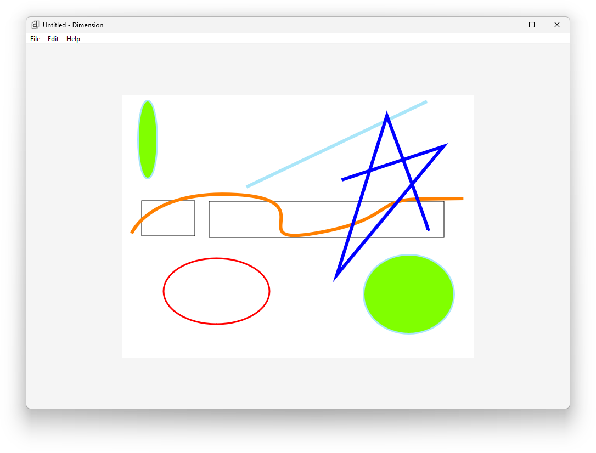

# Dimension

Dimension is a free and open-source animation tool (in future), intended to make animations without paying a single dimme for them. Dimension is the first program defining programmed animation, because we believe - programming is art, and art can be programming, too!



The [previous version](https://git.lmd.vg/ash/dimension-diploma) of the program was created as a college diploma work, but the idea remained and started to improve gradually.

## Building
### Makefile
You can build Dimension with Makefile, which allows you to leverage LLVM, GCC and MinGW. By default, the `make` without any arguments builds Debug target for x64 systems, with LLVM. For initializing build, simply run:

```
make
```

If you wish to customize building and targets, consider adding necessary arguments set:

```
make CONFIG=Release{Debug} ARCH=x86{x64}
```

To build with GCC:

```
make GCC=1
```

### Visual Studio
For building Dimension via Visual Studio, you need Visual Studio 2026 or later, because of it's `.slnx` new format.  
After running, build the entire solution and navigate to appropriate folders, you will have necessary DLLs and libraries, required by Dimension to operate properly.

### Structure
All build structures provide the following structure:

* `(ARCHITECTURE)_(RELEASE)` - architecture (x86, x64) and release (Debug and Release) - here are your compiled binaries,
  * `dimcore.dll` - core definitions of Dimension, such as engine, parser and etc,
  * `dimcore.lib` - static library of Dimension, which can be used independently of DLL,
  * `dimension.exe` - the main client of Dimension, here all visible magic happens :)

## Future
Since Dimension is a program in-works, I have some plans to improve it later:

* Make Dimension fully finished with tuned base and without cross-platform lockers inside core - **In Progress**,
* Port the program into Linux and other operating systems,
* Extend the specifications, and define custom standard of animation,
* Uplift it's look and feel so it will be even easier to use later.
